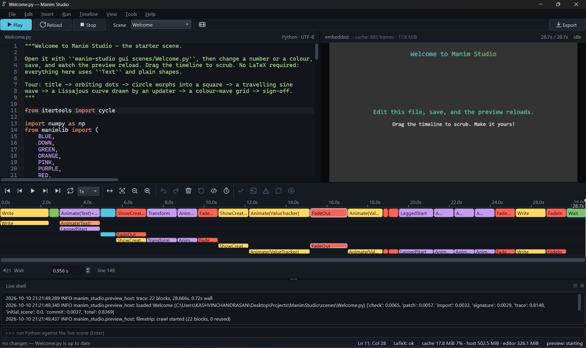
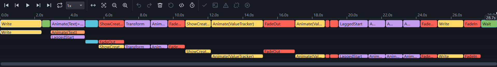
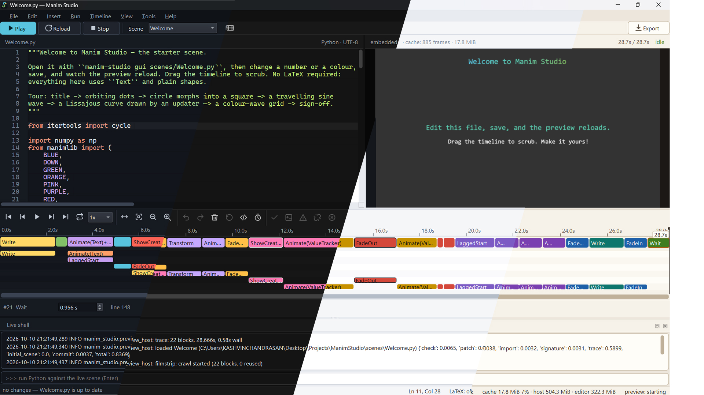
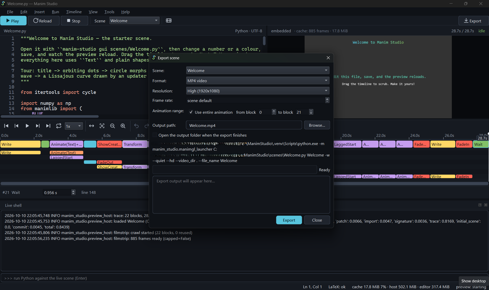

<div align="center">


# Manim Studio

**A realtime desktop editor for [ManimGL](https://github.com/3b1b/manim) scenes.**<br>
Write the scene, watch it render live, and retime it on a timeline.

<p>
  <a href="https://github.com/AzadKshitij/manim-studio/actions/workflows/ci.yml"></a>
  <a href="LICENSE"></a>
  
  
</p>

<p>
  <a href="#quick-start">Quick start</a> ·
  <a href="#features">Features</a> ·
  <a href="#screenshots">Screenshots</a> ·
  <a href="#cli-agent-friendly">CLI</a> ·
  <a href="#development">Development</a> ·
  <a href="CHANGELOG.md">Changelog</a>
</p>



</div>

## Features

- **Code editor** (Scintilla): `manimlib` autocomplete, call signatures, error markers
  that jump to the failing line, and full undo/redo.
- **Realtime preview:** embedded frame streaming (default) or an external GL window,
  plus a live IPython shell wired to the running scene.
- **Timeline from a runtime trace** of `play()`/`wait()`, so loops and branches are
  correct. Drag to scrub the live scene, wheel to pan, Ctrl+wheel to zoom, arrow keys
  to step one frame.
- **Editable timeline:** retime or delete an animation from the timeline or the block
  inspector. Edits are anchored to the call site, not a block index, and saved in
  `<scene>.studio.json`, so your `.py` stays untouched until you choose
  *Timeline > Apply timeline edits to source*. Edits that no longer match a call land
  in an orphan tray instead of being applied to the wrong animation.
- **Scrubbing that feels like video:** a background filmstrip cache is filled in a single
  pass and survives edits that provably cannot affect a block, so it is never stale.
- **Themes:** the built-in Chalkboard theme and loadable JSON theme files.
- **One-click export:** MP4 (up to 4K/60), GIF or a still through headless `manimgl -w`.
  Export honours your timeline edits.
- **Scriptable:** everything is available from a CLI that AI agents can drive.

## Screenshots

<table>
  <tr>
    <td width="50%"><br><sub><b>Timeline.</b> Lanes per animation, block inspector, scrub and orphan tray.</sub></td>
    <td width="50%"><br><sub><b>Themes.</b> Chalkboard and custom JSON themes.</sub></td>
  </tr>
  <tr>
    <td width="50%"><br><sub><b>Export.</b> Quality, fps, resolution and range.</sub></td>
    <td width="50%"><br><sub><b>Editor.</b> Code editor with autocomplete, and error markers.</sub></td>
  </tr>
</table>

> The images in `docs/assets/screenshots/` are placeholders. Replace them with real
> captures using the same file names (PNG, about 1600 px wide for full-window shots).

## Requirements

- Python 3.13 and [`uv`](https://docs.astral.sh/uv/)
- A working OpenGL 3.3 context (preview, traces, stills)
- `ffmpeg` on `PATH` (video export only)
- Optional: a LaTeX installation for `Tex` mobjects (`manim-studio latex install`
  provisions TinyTeX per user)

## Quick start

`scenes/Welcome.py` is the starter scene: a short, LaTeX-free tour (title, orbiting
dots, morphs, a travelling sine wave, a Lissajous curve and a colour-wave grid) to
edit, save and scrub.

```powershell
uv sync --all-groups
uv run manim-studio gui scenes/Welcome.py
```

| Key | Action |
| --- | --- |
| Save | auto-reload the preview |
| `F5` | force a reload |
| `F6` / `F7` | play from the playhead / stop |
| `Ctrl+R` | render a preview video |
| `Ctrl+E` | export the final video |
| ``Ctrl+` `` | open the live shell |

## CLI (agent-friendly)

```text
manim-studio gui   [FILE]            open the desktop editor
manim-studio check FILE              syntax + scene discovery (fast, no GL)
manim-studio trace FILE [--json]     runtime play/wait trace (blocks, stats)
manim-studio still FILE -o OUT.png   render the final frame
manim-studio export FILE -o OUT.mp4  render a video (--quality, --fps, --gif, --resolution WxH, --range FROM,TO)
manim-studio new FILE --template K   scaffold a scene (--list to see templates)
manim-studio preview FILE            standalone GL preview host
manim-studio templates --json        scene + insertable snippet templates
manim-studio api-index --json        offline scan of the installed manimlib API
manim-studio frame FILE --at SECONDS render the scene at one time (PNG, --json)
manim-studio contact-sheet FILE      tile frames with timestamps and block names
manim-studio agent-init [DIR]        write agent instructions and MCP config
manim-studio mcp --root DIR          stdio MCP server for AI agents
```

Exit codes: `0` success, `1` user/scene error, `2` usage error. JSON goes to stdout;
scene output is captured so it can never corrupt structured output.

## Use it with your AI agent

Manim Studio has no built-in AI. Bring the agent you already use.

1. Write the agent instructions and MCP config into your project:

   ```bash
   manim-studio agent-init .
   ```

   This writes a Claude Code skill (`.claude/skills/manim-scene-authoring/SKILL.md`), a Cursor
   rule, a managed block in `AGENTS.md`, and `.mcp.json`. Add `--dry-run` to see the plan first.
   A file you have edited is kept unless you pass `--force`.

2. Register the server, if you did not use `agent-init` for it:
   - Claude Code: `claude mcp add manim-studio -- manim-studio mcp --root .`
   - Cursor: `.cursor/mcp.json` (written by `agent-init`).
   - Other clients: register a stdio server with the command `manim-studio mcp`.

The server works whether or not the editor is open. Every path an agent gives must stay inside
the `--root` folder.

| Tool | What it does |
|------|--------------|
| `check` | syntax and scene discovery, plus LaTeX status (renders nothing) |
| `trace` | blocks with their start times and durations |
| `frame` | one frame at a time, as an image with metadata |
| `contact_sheet` | one image of many frames, each labelled with its time and block |
| `export` | render a video, still or GIF (slow) |
| `list_templates` | scene and snippet templates |
| `api_index` | search the public manimlib names |
| `describe_mobject` | a class's constructor parameters and methods |
| `new_scene` | create a scene file from a template |
| `write_scene` | write a scene's source and check it at once |

A typical session, as the agent works it out:

```text
you:    make a scene where a circle becomes a square, and export it
agent:  new_scene, then check, then trace (confirms the blocks)
agent:  contact_sheet (looks at the tiles and sees the square arrives too early)
agent:  write_scene with a longer run_time, then check, then contact_sheet again
agent:  export with quality low; the video is written next to the scene
```

## How it works

A Qt shell (`manim_studio.editor`) never imports `manimlib`. A companion process
(`manim_studio.preview_host`) owns the only OpenGL context, traces scenes at runtime
and streams frames to the editor over a loopback protocol ([`docs/protocol.md`](docs/protocol.md)).
Timeline edits are patches applied to the source text, and the preview, scrub and export
all run the same patched source. Export shells out to `manimgl -w` for deterministic,
non-interactive rendering. The pure core (`timeline_model`, `site_index`, `patches`,
`sidecar`, `tracer`, `ipc`, `filmstrip`, `reuse`, `theme`, `templates`, `api_index`) has
no GUI/GL dependencies and is exhaustively unit tested.

Design decisions live in [`docs/adr/`](docs/adr/); measured preview performance is in
[`docs/perf/`](docs/perf/README.md).

## Development

```powershell
uv run ruff format src tests && uv run ruff check src tests
uv run mypy
uv run pytest -m "not gl and not slow"   # fast loop
uv run pytest                              # everything, incl. GL + ffmpeg export
```

PowerShell helpers in `scripts/` wrap the same commands:

| script | purpose |
| --- | --- |
| `scripts\run.ps1 [FILE] …` | open the GUI from source (args pass through to `manim-studio gui`) |
| `scripts\lint.ps1 [-Fix]` | format check + ruff + mypy (`-Fix` applies safe autofixes) |
| `scripts\test.ps1 [-m …]` | pytest (args pass through) |
| `scripts\check.ps1 [-Fast]` | full pre-commit gate: lint + pytest (`-Fast` skips GL/slow tests) |
| `scripts\clean.ps1 [-Venv]` | remove `dist/`, `build/`, caches, `__pycache__` (`-Venv` also drops `.venv`) |
| `scripts\build.ps1 …` | release pipeline: gate → PyInstaller bundle → smoke tests → portable zip → installer |

`AGENTS.md` is the full contract for the codebase, and the skills in `.opencode/skills/`
cover scene authoring and codebase workflows. `tests/scenes/feature_showcase.py` is the
canonical scene that exercises every editor, timeline and scene-API feature.

## Packaging (Windows installer + portable)

`scripts\build.ps1` produces everything under `dist/` (see
[`docs/adr/0005-frozen-packaging.md`](docs/adr/0005-frozen-packaging.md)):

- `dist\ManimStudio\`: the application folder, with `ManimStudio.exe` (double-click GUI)
  and `manim-studio.exe` (console CLI for terminals and AI agents).
- `dist\ManimStudio-<version>-portable.zip`: unzip and run anywhere.
- `dist\ManimStudio-Setup-<version>.exe`: Inno Setup installer (per-user, no admin
  prompt); skipped with `-SkipInstaller` or when Inno Setup 6 is missing.

The frozen app still needs `ffmpeg` on `PATH` for video export, and optionally LaTeX.

## Contributing

Contributions are welcome. Start with [`CONTRIBUTING.md`](CONTRIBUTING.md); the
repository's mandatory contract is [`AGENTS.md`](AGENTS.md). Before any commit, run the
gate:

```powershell
uv run ruff format src tests && uv run ruff check src tests && uv run mypy && uv run pytest
```

Please also read the [`CODE_OF_CONDUCT.md`](CODE_OF_CONDUCT.md), and report security
issues privately per [`SECURITY.md`](SECURITY.md).

## License

[MIT](LICENSE) © 2026 Manim Studio Team. Manim Studio is an independent project and is
not affiliated with or endorsed by the ManimGL/Manim community.
